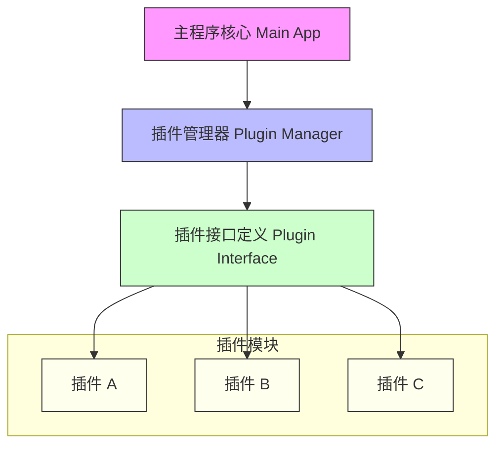

# 插件模式：灵活扩展的架构系统

插件模式（Plugin Pattern）是一种设计模式，它不属于经典的 GoF 设计模式，但在现代编程中经常用到，具有重要作用。它允许你在不修改主程序代码的情况下，通过“加载”独立的**插件模块**来扩展系统功能。

换句话说，插件模式是一种**模块化、可插拔**的架构风格，让你能动态加载和使用“外部模块”，而这些模块只需遵守一定的接口规范即可。

:::tip 核心思想 🌟

主程序提供插件框架，插件只需注册自己，系统就能调用它。

:::


## 模式结构（UML 类图）



图示说明：

- **主程序（Main App）** 不直接依赖插件，而是通过一个 **插件管理器**。
- 插件管理器会依据某种协议或接口定义（如抽象类、注册规范）与插件通信。
- 插件模块（A、B、C）都实现了统一的 **插件接口**（Plugin Interface），因此可以被统一加载和调用。
- 每个插件是独立的，遵循“开闭原则”：对主程序关闭、对扩展开放。


## 插件模式实现要点

- 主程序提供统一的**接口或约定**（协议）；
- 插件实现这个接口或协议；
- 主程序在运行时**动态加载插件**；
- 插件可以按需注册、启用、卸载，甚至热插拔（无需重启程序）。


## 示例：Python 实现插件系统

这个示例一共用了三个文件：

```bash
plugin_system.py     # 插件管理系统
hello_plugin.py      # 插件实现
main.py              # 程序入口，运行插件
```

`plugin_system.py` 是插件管理系统的核心框架代码，它的作用包括：

- 定义插件的 **统一接口**（PluginBase）；
- 提供一个 **插件注册表**（`plugins` 字典）；
- 提供插件注册函数 `register_plugin(name, cls)`；
- 提供插件运行函数 `run_plugin(name)`。

```python showLineNumbers title="plugin_system.py"
# 插件接口规范
class PluginBase:
    def run(self):
        raise NotImplementedError

# 插件注册表
plugins = {}

# 注册函数
def register_plugin(name, cls):
    if issubclass(cls, PluginBase):
        plugins[name] = cls()
    else:
        print(f"Plugin {name} does not implement PluginBase.")

# 启动插件
def run_plugin(name):
    if name in plugins:
        plugins[name].run()
    else:
        print(f"No such plugin: {name}")
```

`hello_plugin.py` 是一个插件实现模块，插件开发者只需要实现这个文件即可。在这个示例，它需要完成以下工作：

- 引入 `PluginBase` 基类和 `register_plugin` 函数；
- 实现一个插件类（`HelloPlugin`），继承自 `PluginBase`；
- 调用 `register_plugin()` 注册这个插件。

```python showLineNumbers title="hello_plugin.py"
from plugin_system import PluginBase, register_plugin

class HelloPlugin(PluginBase):
    def run(self):
        print("Hello from HelloPlugin!")

register_plugin("hello", HelloPlugin)

```

`main.py` 是整个系统的主程序入口。在这里通过 `import` 直接导入插件，然后调用 `run_plugin("hello")` 启动插件逻辑。

```python showLineNumbers title="main.py"
import hello_plugin  # 模拟动态导入插件模块
from plugin_system import run_plugin

run_plugin("hello")
```

:::tip

在实际的 Python 项目中，你可以通过 `importlib` 和扫描插件目录的方式动态加载 `.py` 文件，从而实现自动加载。

:::


## 示例：C 语言实现插件系统

由于 C 没有类和模块系统，所以我们通过 **函数指针 + 结构体** 来模拟插件机制。

```bash
plugin.h            # 插件接口定义
plugin_registry.c   # 插件注册表与注册函数
plugin_registry.h   # 注册表头文件
hello_plugin.c      # 插件 A 实现
main.c              # 主程序入口
```

`plugin.h` 文件定义了插件的结构体 `Plugin`，所有插件都必须使用这个接口结构体进行实现。`Plugin` 结构体可以认为是插件和主程序之间的桥梁或协议定义。

```c showLineNumbers title="plugin.h"
#ifndef PLUGIN_H
#define PLUGIN_H

typedef struct Plugin {
    const char* name;
    void (*run)();
} Plugin;

#endif
```

`plugin_registry.h` 是插件注册表头文件，声明了插件系统相关接口函数。

```c showLineNumbers title="plugin_registry.h"
#ifndef PLUGIN_REGISTRY_H
#define PLUGIN_REGISTRY_H

#include "plugin.h"

#define MAX_PLUGINS 10

void register_plugin(Plugin* plugin);
Plugin* get_plugin_by_name(const char* name);
void run_all_plugins();

#endif
```

`plugin_registry.c` 是插件注册表实现，实现了插件注册等关键函数。

```c showLineNumbers title="plugin_registry.c"
#include <stdio.h>
#include <string.h>
#include "plugin_registry.h"

static Plugin* plugins[MAX_PLUGINS];
static int plugin_count = 0;

void register_plugin(Plugin* plugin) {
    if (plugin_count < MAX_PLUGINS) {
        plugins[plugin_count++] = plugin;
    } else {
        printf("插件数量超过上限！\n");
    }
}

Plugin* get_plugin_by_name(const char* name) {
    for (int i = 0; i < plugin_count; ++i) {
        if (strcmp(plugins[i]->name, name) == 0) {
            return plugins[i];
        }
    }
    return NULL;
}

void run_all_plugins() {
    for (int i = 0; i < plugin_count; ++i) {
        printf("运行插件：%s\n", plugins[i]->name);
        plugins[i]->run();
    }
}
```

`hello_plugin.c` 文件是插件实现模块，它定义了一个实际的插件行为函数 `hello_run()`。

```c showLineNumbers title="hello_plugin.c"
#include <stdio.h>
#include "plugin.h"
#include "plugin_registry.h"

void hello_run() {
    printf("Hello 插件运行中！\n");
}

Plugin hello_plugin = {
    .name = "hello",
    .run = hello_run
};

// 注册插件
__attribute__((constructor))
void init_plugin() {
    register_plugin(&hello_plugin);
}
```

这里使用 GCC 的一个特性 `__attribute__((constructor))`，确保插件在程序启动时自动注册。

`main.c` 文件是主程序入口。

```c showLineNumbers title="main.c"
#include <stdio.h>
#include "plugin_registry.h"

int main() {
    printf("主程序启动\n");

    run_all_plugins();  // 自动运行所有已注册插件

    Plugin* p = get_plugin_by_name("hello");
    if (p) {
        printf("手动运行插件：%s\n", p->name);
        p->run();
    } else {
        printf("插件未找到！\n");
    }

    return 0;
}
```

编译程序，输出结果如下：

```bash
主程序启动
运行插件：hello
Hello 插件运行中！
手动运行插件：hello
Hello 插件运行中！
```


:::tip

在 C 语言中，更复杂的插件系统会使用 `dlopen()` / `dlsym()` 加载 `.so` 文件（Linux）或 `.dll`（Windows）实现动态加载。

:::


## 插件模式的优缺点

**✅ 优点**

- **高扩展性**：不需要修改主程序即可添加功能。
- **高模块化**：插件可以独立开发、测试、部署。
- **动态加载**：支持按需加载、卸载，甚至热更新。
- **开放封闭原则**：主程序封闭，插件可无限扩展。

**❌ 缺点**

- **架构复杂度提升**：建议在设计时定义好插件接口，避免耦合。
- **插件不受控**：建议将插件加入版本控制、权限系统，加强管理。
- **插件异常可能影响主程序**：建议加入插件隔离机制或沙箱，避免主程序异常。


## 小结

插件模式是一种结构清晰、灵活扩展的架构设计方式。它适用于：

- 编辑器（如 VS Code 插件系统）
- 浏览器扩展
- 游戏（如 Unity Mods）
- 编译器/构建系统（如 ESLint 插件）
- 后台系统（动态扩展业务模块）

插件模式不是 GoF 的 23 种经典设计模式之一，但它是现代系统架构中**极其常见**的设计手法。

