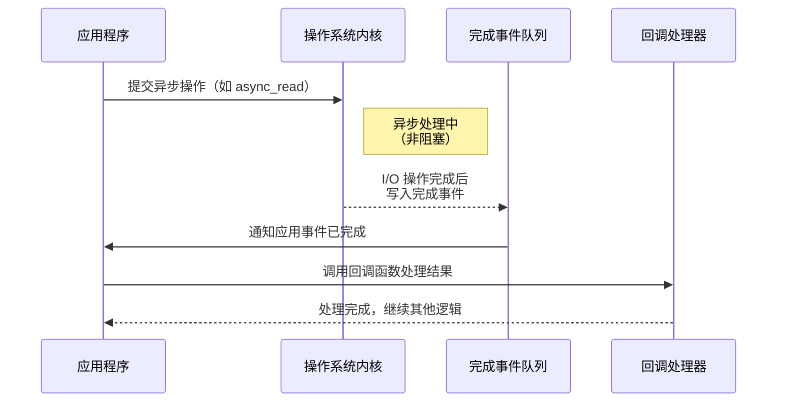

# Proactor 模式：事件驱动模型

你已经了解了 [Reactor 模式](/design-patterns/reactor/)，知道它通过“监听 + 回调”的方式实现高并发处理。但你可能还听说过一个更“智能”的兄弟模式：**Proactor 模式**。这两个模式经常被并列讲解，但它们的本质不同。Reactor 是程序主动反应事件，而 Proactor 是操作系统预先完成并通知事件。


## Proactor 模式是什么？

Proactor 模式是“主动提交异步操作，等系统完成后自动通知并调用处理器”的一种设计模式。在 Proactor 模式中，你不再等待事件，而是把“我要干什么”告诉系统，等它完成再告诉你。（💡 关键词：异步 I/O、系统完成、回调处理器）

想象你去银行办理业务：

- **Reactor 模式**：你站在窗口前一直盯着，工作人员喊你才去办理（事件发生后，你负责响应）；
- **Proactor 模式**：你填好资料，交给前台说“你办好了叫我”，然后你去玩手机，等处理完成后系统通知你（操作系统帮你完成 I/O）。

所以，Proactor 是“由操作系统完成 I/O，然后通知你”，Reactor 是“由你监听 I/O 是否就绪，然后自己来完成处理”。


## Proactor 典型应用场景

Proactor 模式广泛应用于支持**原生异步 I/O** 的操作系统中，尤其是：

| 系统                                 | 特点                                          |
| ------------------------------------ | --------------------------------------------- |
| Windows IOCP（I/O Completion Ports） | 最经典的 Proactor 应用，线程池 + 回调         |
| Boost.Asio（C++）                    | 使用 Proactor 模式实现跨平台网络库            |
| libuv（Node.js 底层）                | 在 Windows 上用 IOCP，在 Unix 上模拟 Proactor |
| .NET async/await                     | 底层就是基于 Proactor 异步完成模型            |


## Proactor 核心组成部分

| 组件                             | 说明                       |
| -------------------------------- | -------------------------- |
| 异步操作请求（Async Operation）  | 发起一次异步读/写操作      |
| 操作系统内核                     | 在后台执行 I/O，完成后通知 |
| 完成事件队列（Completion Queue） | I/O 操作完成后排队通知应用 |
| 回调处理器（Completion Handler） | 操作完成时调用的函数/对象  |

Proactor 模式的交互过程如下图所示：



图解说明：

- **App → OS**：应用发起异步请求；
- **OS → Queue**：操作系统完成后，把结果放入完成队列；
- **Queue → App**：通知应用，操作完成；
- **App → Handler**：回调处理逻辑；
- **Handler → App**：处理结果，回到主流程。


## 和 Reactor 模式的对比

| 对比点           | Reactor                     | Proactor               |
| ---------------- | --------------------------- | ---------------------- |
| I/O 类型         | 同步非阻塞 I/O              | 异步 I/O               |
| 谁负责执行 I/O   | 用户代码主动读/写           | 操作系统执行           |
| 用户什么时候处理 | I/O 准备好后，自己调用读/写 | I/O 已完成，收到通知   |
| 性能表现         | 较高                        | 更高（更少的系统调用） |
| 使用门槛         | 简单，跨平台                | 依赖操作系统支持       |

**简单理解：Reactor 是“监听 + 读写”，Proactor 是“提交 + 回调”。**


## 示例：C++ Boost.Asio 的 Proactor

这是一个使用 Boost.Asio（基于 Proactor）的异步 TCP 服务端示例：

```cpp showLineNumbers
#include <boost/asio.hpp>
#include <iostream>

using boost::asio::ip::tcp;

void handle_read(const boost::system::error_code& ec, std::size_t bytes) {
    if (!ec) {
        std::cout << "收到数据：" << bytes << " 字节" << std::endl;
    }
}

int main() {
    boost::asio::io_context io;
    tcp::acceptor acceptor(io, tcp::endpoint(tcp::v4(), 8888));

    tcp::socket socket(io);
    acceptor.accept(socket);

    char buffer[1024];
    socket.async_read_some(boost::asio::buffer(buffer), handle_read);

    io.run();  // 开始处理异步操作
}
```

在这个例子中，你只需调用 `async_read_some()`，然后注册一个回调函数，**真正的读取操作由系统完成，读完后再通知你**。


## Proactor 的优缺点

**✅ 优点**

- 性能更高（无阻塞等待）
- 系统完成 I/O，减少上下文切换
- 适合线程池 + 多核并发

**❌ 缺点**

- 实现复杂（需要异步接口支持）
- 跨平台兼容性较差（Unix 下很难实现真正的 Proactor）


## FAQs

**Q1：Unix/Linux 上为什么很少用 Proactor？**

因为大多数 Unix 系统（如 Linux）不原生支持真正的异步 I/O：

- `epoll` / `select` / `poll` 都是 I/O 就绪通知机制，本质是 Reactor。
- Linux 的 AIO（`libaio`）复杂、不稳定，使用较少。
- 于是很多框架（如 Node.js 的 libuv）会在 Linux 上模拟 Proactor：底层其实用的是 epoll。


## 小结

Proactor 模式是将 I/O 操作委托给操作系统完成，等完成后自动触发处理逻辑的一种事件驱动模式。它适合高性能服务器、异步框架、IO 密集系统，在 Windows 平台和 C++/C# 开发中非常常见，是理解现代异步编程的重要一环。
