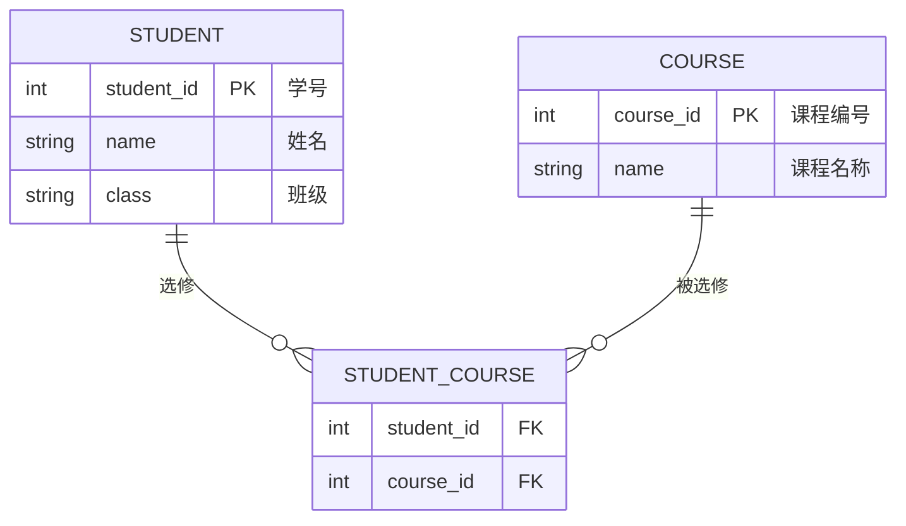

# 数据库设计 - 将 ER 图转换为关系模型

上一节中你学习了如何绘制 ER 图，它帮助你从“概念层”理解系统中的数据结构。但最终，我们需要将这些概念落地成数据库中的表结构，而这就需要把 ER 图“翻译”为关系模型（Relation Model）。

本节将带你逐步了解如何从 ER 图转换为关系模型，重点包括实体、关系、多对多和一对多之间的转换规则，并辅以实用示例，帮助你真正掌握数据库逻辑设计的核心技巧。


## 什么是关系模型？

关系模型是关系型数据库的基础，它用“表（table）”的形式表示数据，每一张表就是一个关系。

你可以把关系模型理解为：

- 每个**实体**转换为一张表；
- 每个**属性**成为表中的一列（字段）；
- 每个**主键**用于唯一标识一行数据；
- **实体之间的关系**，则通过主键和外键来表达。


## 转换的基本规则

下面我们来看具体转换规则：

### 1. 实体 -> 表

每个实体对应一张表，实体的属性变成表的字段，主键在表中依然作为主键使用。

🟢 示例：

实体 `STUDENT`：

```pgsql
属性：student_id（主键）、name、class
```

转换后表结构为：

|   字段名   |  类型   | 主键 |
| :--------: | :-----: | :--: |
| student_id |   INT   |  是  |
|    name    | VARCHAR |  否  |
|   class    | VARCHAR |  否  |


### 2. 一对多关系 -> 外键

如果实体 A 与实体 B 存在一对多关系（A:1 → B:N），就在“多”的那一方加入“单”的那一方的主键作为外键。

🟢 示例：

一个班级有多个学生（CLASS:1 → STUDENT:N）

- 班级表：`CLASS(class_id PK, name)`
- 学生表：`STUDENT(student_id PK, name, class_id FK)`


### 3. 多对多关系 -> 中间表

如果两个实体之间是多对多关系（M:N），你需要创建一个“中间表”来单独表示这种关系，并在中间表中包含双方的主键作为外键。

🟢 示例：

学生选修课程（STUDENT:M ↔ COURSE:N）

- 学生表：`STUDENT(student_id PK, name)`
- 课程表：`COURSE(course_id PK, name)`
- 选课表（中间表）：`STUDENT_COURSE(student_id FK, course_id FK, 选课时间)`

中间表的主键可以是组合键（student_id, course_id），也可以设置一个独立的主键字段。


### 4. 一对一关系 -> 合并或外键

一对一关系可以：

- 合并为一个表（如果两个实体密切相关）；
- 或在任意一方加入对方主键作为外键（有时也作为主键使用）。

🟢 示例：

一个学生对应一个档案（STUDENT 1:1 PROFILE）

- 合并成：`STUDENT(student_id PK, name, ...profile 属性...)`
- 或者分表：`PROFILE(student_id PK & FK, 出生地, 身高, ... )`


## 完整示例：从 ER 图到关系模型

我们来回顾你前面画的 ER 图：

```
实体：STUDENT（学号、姓名、班级）
实体：COURSE（课程编号、课程名称）
关系：STUDENT 选修 COURSE（多对多）
```




👉 转换后关系模型如下：

```sql
-- 学生表
CREATE TABLE STUDENT (
    student_id INT PRIMARY KEY,
    name VARCHAR(50),
    class VARCHAR(50)
);

-- 课程表
CREATE TABLE COURSE (
    course_id INT PRIMARY KEY,
    name VARCHAR(100)
);

-- 中间表：选课记录
CREATE TABLE STUDENT_COURSE (
    student_id INT,
    course_id INT,
    enroll_time DATETIME,
    PRIMARY KEY (student_id, course_id),
    FOREIGN KEY (student_id) REFERENCES STUDENT(student_id),
    FOREIGN KEY (course_id) REFERENCES COURSE(course_id)
);
```

这样你就完成了从 ER 图 → 表结构的整个转换过程。


## 转换时的注意事项

- 不要遗漏外键关系，否则实体之间就“断线”了；
- 如果属性属于关系（而不是某个实体），应当放入中间表中；
- 主键和外键一定要清晰地定义，避免数据不一致；
- 设计时尽量避免冗余字段，为后续规范化打基础。


## 小结

在本节中，你学习了：

1. 什么是关系模型，它是数据库中实际使用的表结构；
2. 如何将实体、属性、关系转换为关系模型中的表和字段；
3. 一对多、多对多、一对一等关系的具体转换方法；
4. 通过选课系统的示例，掌握了完整的转换流程。

通过 ER 图的概念建模和关系模型的逻辑设计，你现在已经具备了从“需求”到“表结构”的能力。
