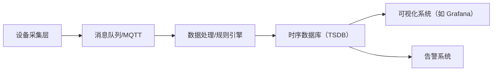

# 物联网时代的时序数据库

在日常生活中，你经常会接触到各种与“时间”相关的数据，比如：

- 一台传感器每隔 10 秒记录一次温度
- 股票市场每分钟更新一次价格
- 服务器每秒产生上百条性能指标

这些数据都有一个共同特点：**数据点按照时间顺序产生，时间是它们最重要的属性**。这类数据被称为 **时序数据**（Time Series Data），而专门用来存储和分析这类数据的数据库，就叫做 **时序数据库**（Time Series Database，简称 TSDB）。

这节课，你将了解时序数据库的基本概念、特点、常见应用场景以及它与传统数据库的区别。


## 什么是时序数据库？

时序数据库是一种专门设计用于存储、管理和分析 **按时间顺序排列的数据点** 的数据库系统。每一条时序数据通常包含以下几个基本组成：

- 时间戳（Timestamp）：记录数据产生的时间
- 一个或多个数值（Value）：如温度、电压、点击量等
- 标签/维度（Tags/Labels）：用于标识数据的来源、类型或其他附加信息（如设备 ID、位置等）

举个例子：假设你有一台设备 `device-01`，它每 10 秒上报一次温度和电压数据，记录如下。

```bash
时间戳                 设备ID       温度(℃)    电压(V)
2025-04-17 10:00:00   device-01   23.5       3.3
2025-04-17 10:00:10   device-01   23.6       3.3
2025-04-17 10:00:20   device-01   23.7       3.2
```

这些数据可能会不断地追加进数据库，并且常常会在图表上展示它们随时间的变化趋势。写入时序数据库后，你就可以执行一些查询操作，例如最近 10 分钟内温度的平均值、某一天每小时的最大电压等等。


## 时序数据库的核心特点

1. **高效写入性能**

   你可以快速连续地向时序数据库中写入大量数据点，它们会按照时间顺序组织，并尽量减少存储空间的浪费。

2. **时间第一重要**

   时间戳在时序数据库中占据“第一重要”的地位。你经常会使用“过去 1 小时的数据”、“每天的平均值”、“在 9:00 到 10:00 之间的峰值”等查询。

3. **数据压缩能力强**

   由于时序数据往往具有连续性和相似性，时序数据库可以通过压缩算法极大地减少存储空间（比如使用差分存储、滑动窗口等方式）。

4. **查询优化**

   专门针对时间范围、聚合计算（平均、最大、最小、求和）等查询做了优化。

5. **内置的下采样（Downsampling）能力**

   你可以从原始数据中生成低分辨率的“摘要”，比如每 1 小时平均值、每天最大值，以节省查询开销。


## 与传统数据库的对比

|     特点     | 关系型数据库（如 MySQL） | 时序数据库（如 InfluxDB） |
| :----------: | :----------------------: | :-----------------------: |
|   数据组织   |     按表组织，结构化     |  按时间线追加，结构可变   |
|   查询方式   |     多样的 SQL 查询      | 更偏向时间范围、聚合分析  |
| 性能优化方向 |   行/列存储、索引优化    | 写入性能、压缩、时间窗口  |
|   适用场景   |     一般业务数据存储     |  高频率时间序列数据分析   |

虽然关系型数据库也可以存储带时间的数据，但在**写入效率、压缩比、聚合性能**上，远远比不上专业的时序数据库。


## 为什么物联网离不开 TSDB？

在物联网（IoT）场景中，最常见的数据就是“时间 + 状态”的组合。例如：

- 一只智能手环每分钟记录一次心率
- 一台电表每 10 秒汇报一次电压、电流
- 一个温湿度传感器每 5 秒记录一次室内环境

这些数据的本质就是**时序数据**，而这些数据通常具备以下特点：

|        特性        | 描述                                             |
| :----------------: | ------------------------------------------------ |
|       连续性       | 数据源源不断地生成，每个数据点都有时间戳。       |
|     写入频率高     | 大量设备高频上报数据，比如每秒、每分钟。         |
| 查询时基于时间维度 | 你经常需要查询“过去一小时内的温度变化”这类请求。 |
|    数据体量巨大    | 设备数量多，数据持续产生，存储压力大。           |

时序数据库就是为这种“按时间顺序写入和读取数据”的场景而设计的，可以帮助你更高效地写入、存储、压缩和查询这些数据。

在实际的物联网平台架构中，时序数据库一般处于“数据采集”与“可视化分析”之间：



你可以通过 MQTT 协议接入设备数据，将其写入 TSDB，再通过可视化平台绘制图表、生成报表、触发报警等。


## 常见的应用场景

时序数据库广泛应用于以下领域：

| 应用领域        | 示例                                 |
| --------------- | ------------------------------------ |
| 🌡️ 物联网（IoT） | 传感器数据、智能家居、工业设备状态。 |
| 🖥️ IT 运维       | CPU 使用率、内存占用、网络流量监控。 |
| 📈 金融行情      | 股票价格变化、交易量。               |
| ⚡ 能源监控      | 电力使用数据、光伏发电监控。         |
| 🚀 工业控制      | 工厂产线实时监测、预测性维护。       |


## 常见的时序数据库

以下是一些主流的时序数据库产品：

|    名称     | 简介                                      | 是否开源 |
| :---------: | ----------------------------------------- | :------: |
|  InfluxDB   | 轻量高效，查询语法类似 SQL，易用性强。    |    ✅     |
| TimescaleDB | 基于 PostgreSQL，兼具关系模型与时序特性。 |    ✅     |
| Prometheus  | 适合监控指标收集与报警，和 IoT 有交集。   |    ✅     |
|  TDengine   | 国产 TSDB，主打物联网高性能。             |    ✅     |
|  OpenTSDB   | 构建于 HBase 之上，适合大规模数据存储。   |    ✅     |
|   QuestDB   | 兼容 SQL，金融/工业领域高频数据处理。     |    ✅     |


## 小结

时序数据库是一类专为**时间序列数据**设计的数据库系统，适合高频写入、时间聚合和压缩存储等场景。在物联网、运维监控、金融数据等领域都有广泛的应用。相比传统数据库，它们对“时间”这一维度有更深层的优化与理解，是你在处理大规模、连续变化数据时的重要工具之一。
