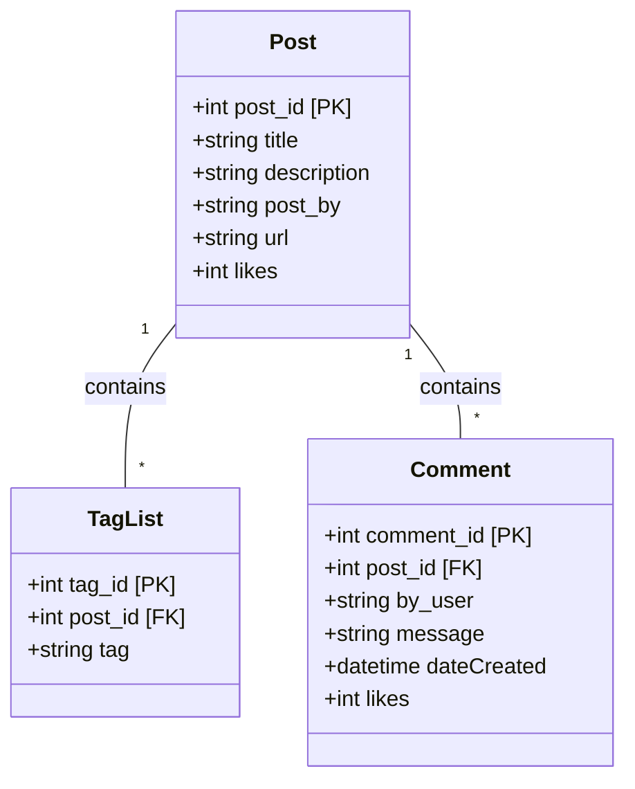

# MongoDB 数据模型

与传统关系型数据库不同，MongoDB 是一种非关系型数据库，它以灵活的文档结构存储数据，而不是像关系型数据库那样依赖固定的表结构。这种灵活性使得 MongoDB 在处理复杂数据时更加高效，尤其是在面对快速变化的应用场景时。接下来，就让我们一起深入探索 MongoDB 的数据模型设计。


## 数据模型设计

MongoDB 提供了两种主要的数据模型：**嵌入式数据模型**（Embedded Data Model）和**规范化数据模型**（Normalized Data Model）。你可以根据具体需求选择适合的模型来设计文档。

### 嵌入式数据模型

在嵌入式数据模型（Embedded Data Model）中，你可以将所有相关数据嵌入到一个文档中，这种模型也被称为**去规范化**数据模型（De-normalized Data Model）。例如，假设你需要存储员工的个人信息、联系方式和地址，你可以将这三个部分嵌入到一个文档中，如下所示：

```json showLineNumbers
{
	_id: ,
	Emp_ID: "20230426001",
	Personal_details: {
		First_Name: "张",
		Last_Name: "三",
		Date_Of_Birth: "1995-09-26"
	},
	Contact: {
		e-mail: "zhangsan@example.com",
		phone: "13800138000"
	},
	Address: {
		city: "北京",
		Area: "海淀区",
		State: "北京市"
	}
}
```

这种方式的优点是数据集中存储，查询时无需进行复杂的连接操作，读取效率高。


### 规范化数据模型

规范化数据模型（Normalized Data Model）则通过引用将子文档与主文档关联起来。例如，你可以将员工的个人信息、联系方式和地址分别存储为独立的文档，并通过引用关联它们，如下所示：

**Employee 文档：**

```json showLineNumbers
{
	_id: <ObjectId101>,
	Emp_ID: "20230426001"
}
```

**Personal_details 文档：**

```json showLineNumbers
{
	_id: <ObjectId102>,
	empDocID: "ObjectId101",
	First_Name: "张",
	Last_Name: "三",
	Date_Of_Birth: "1995-09-26"
}
```

**Contact 文档：**

```json showLineNumbers
{
	_id: <ObjectId103>,
	empDocID: "ObjectId101",
	e-mail: "zhangsan@example.com",
	phone: "13800138000"
}
```

**Address 文档：**

```json showLineNumbers
{
	_id: <ObjectId104>,
	empDocID: "ObjectId101",
	city: "北京",
	Area: "海淀区",
	State: "北京市"
}
```

在这个规范化数据模型中，员工的基本信息、个人信息、联系方式和地址被分别存储在不同的文档中，并通过 `empDocID` 进行关联。这种方式可以减少数据冗余，但查询时可能需要进行多次连接操作，适合数据更新频繁的场景。


## 数据模型设计规则

在 MongoDB 中设计数据模型时，通常遵循以下几个基本原则：

- **需要被一起使用的数据，应该被存储在一起。**
- **应用层查询数据时，应该尽可能减少访问次数。**
- **数据模型要考虑未来可能的变化，具备灵活性。**

这种设计方式最大限度地发挥了 MongoDB 文档存储的优势，同时还能提升应用的性能和可扩展性。

因此，在实践过程中，你需要考虑以下几点：

- 根据用户需求设计数据模型。
- 如果你经常需要同时使用多个对象，可以将它们合并到一个文档中；否则，将它们分开（但要确保不需要进行连接操作）。
- 适当重复数据（但要有限制），因为磁盘空间相对计算时间来说较为廉价。
- 在写入时进行连接操作，而不是在读取时。
- 优化数据模型以满足最常见的使用场景。
- 在数据模型中进行复杂的聚合操作。


## 示例：博客网站数据库

假设你需要为一个博客网站设计数据库，来看看 MongoDB 和关系型数据库（RDBMS）在数据模型设计上的差异。网站有以下需求：

- 每篇帖子都有唯一的标题、描述和 URL。
- 每篇帖子可以有一个或多个标签。
- 每篇帖子都有发布者的姓名和总点赞数。
- 每篇帖子都有用户评论，评论包含评论者姓名、评论内容、评论时间以及点赞数。
- 每篇帖子可以有零个或多个评论。

在关系型数据库中，满足上述需求的设计至少需要三个表。而在 MongoDB 中，设计如下：

```json showLineNumbers
{
   _id: POST_ID,
   title: TITLE_OF_POST,
   description: POST_DESCRIPTION,
   by: POST_BY,
   url: URL_OF_POST,
   tags: [TAG1, TAG2, TAG3],
   likes: TOTAL_LIKES,
   comments: [
      {
         user:'COMMENT_BY',
         message: TEXT,
         dateCreated: DATE_TIME,
         like: LIKES
      },
      {
         user:'COMMENT_BY',
         message: TEXT,
         dateCreated: DATE_TIME,
         like: LIKES
      }
   ]
}
```

在展示数据时，关系型数据库需要连接三个表，而 MongoDB 只需要从一个集合中获取数据。

以下是关系型数据库中 `comment_id`、`post` 和 `tag_list` 三个表的结构示意图：



- `post` 表通过 `post_id` 与 `tag_list` 表和 `comment` 表关联。
- `tag_list` 表通过 `post_id` 关联到 `post` 表。
- `comment` 表通过 `post_id` 关联到 `post` 表。

这种关系型数据库的设计方式需要通过表之间的外键关联来实现数据的完整性，查询时可能需要进行多表连接操作。相比之下，MongoDB 的文档模型可以将所有相关数据存储在一个文档中，从而简化查询操作。


## 小结

通过本文的介绍，你已经了解了 MongoDB 的两种数据模型：嵌入式数据模型和规范化数据模型。嵌入式数据模型将相关数据集中存储，适合读取频繁的场景；规范化数据模型通过引用关联数据，适合数据更新频繁的场景。在设计数据模型时，要根据实际需求权衡选择，并注意优化数据模型以提高查询效率。希望本文能帮助你更好地理解和应用 MongoDB 数据模型。
